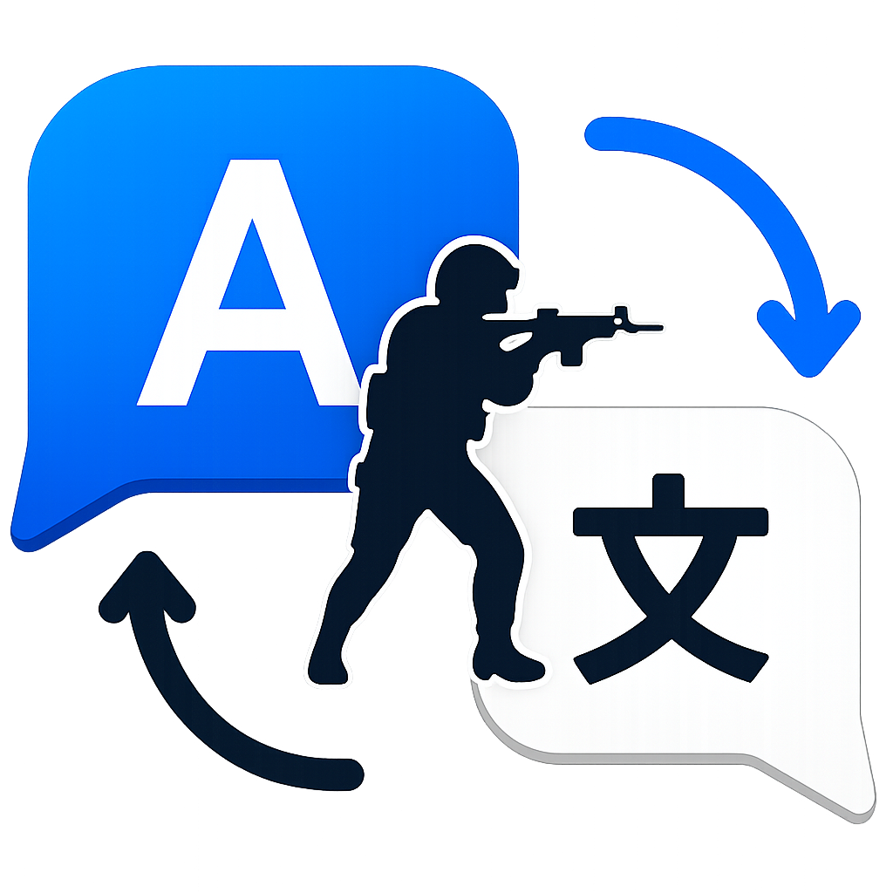
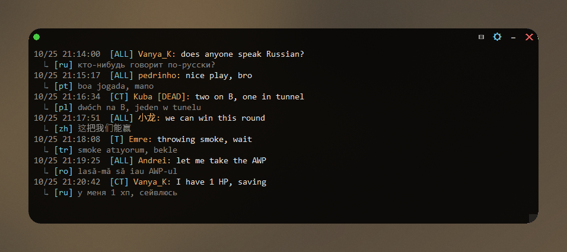
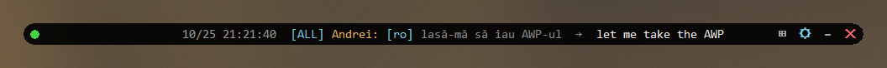
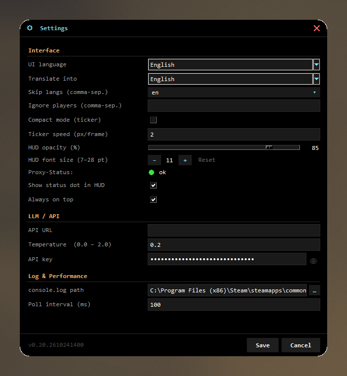

<div align="center">



# CounterTranslate

**Real-time chat translation for Counter-Strike 2, in a transparent overlay.**<br>
Russian, Polish, Turkish, Chinese — read every message in your own language without alt-tabbing.

[](https://github.com/Crankerer/CounterTranslate/releases)
[](#requirements)
[](LICENSE)

<a href="doc/hud.png"></a>

[Quick start](#quick-start) · [Features](#features) · [Shortcuts](#keyboard-shortcuts) · [Settings](#settings) · [How it works](#how-it-works) · [Troubleshooting](#troubleshooting) · [Development](#development)

</div>

---

### ⚡ Instant
New chat lines are picked up as CS2 writes them and translated within a second or two.

### 🌍 Every language
The source language is detected automatically. Languages you already speak are skipped.

### 🪶 Out of your way
Transparent, always on top, draggable — or shrink it to a one-line ticker, or minimize it to the taskbar.

### 📄 Reads a log file, nothing else
It reads the `console.log` that CS2 writes itself. It never attaches to the game process.

---

## Quick start

1. **Enable the CS2 log.** In Steam, right-click **Counter-Strike 2** → **Properties** → **Launch Options** and enter:
   ```
   -condebug
   ```
2. **Download** the latest `CounterTranslate-windows-x64.zip` from the [Releases page](https://github.com/Crankerer/CounterTranslate/releases), extract it and run `CounterTranslate.exe`.
3. **Point it at CS2.** On first launch, pick your `Counter-Strike Global Offensive` folder — the path to `console.log` is filled in for you.
4. **Add your key.** Click ⛭ in the overlay's top bar and paste your key into **API key** (see [API key](#api-key)).
5. **Play.** Translations appear in the overlay as soon as someone writes in chat.

> [!NOTE]
> `console.log` is usually at `C:\Program Files (x86)\Steam\steamapps\common\Counter-Strike Global Offensive\game\csgo\console.log`. Restart CS2 once after setting `-condebug` so the file gets created.

### API key

CounterTranslate sends each chat message to an OpenAI-compatible chat-completions endpoint:

| You have | API URL setting | API key setting |
|----------|-----------------|-----------------|
| A CounterTranslate key (`ct-…`) | leave empty — the built-in CounterTranslate endpoint is used | your `ct-…` key |
| Your own OpenAI key (`sk-…`) | `https://api.openai.com/v1/chat/completions` | your `sk-…` key from [platform.openai.com](https://platform.openai.com/api-keys) |
| Another OpenAI-compatible server (e.g. a local model in LM Studio) | that server's chat-completions URL | whatever the server expects |

When a custom API URL is set, a **Model** field appears so you can choose the model name.

---

## Features

### Full overlay

Every message shows the translation first and the original underneath, tagged with the detected language. Team and all-chat scopes, dead and spectating players and all CS2 client languages are recognised.

- Drag the window anywhere, resize it from the bottom-right corner
- Adjustable opacity (F2 or the settings slider) and font size (Ctrl+MouseWheel)
- Player names can be ignored, and languages you speak are never translated
- Keeps your position, size, font and opacity between sessions

### Compact ticker

<a href="doc/compact.png"></a>

Click ⊟ to collapse the overlay into a single scrolling line that takes almost no screen space; ⊞ brings the full view back. The scroll speed is configurable.

### Minimize to the taskbar

Click − in the top bar (in either mode) to send the overlay to the taskbar, like any other window. Click its taskbar button to bring it back.

### Status dot

The dot in the top-left corner shows the health of the translation endpoint. Hover over it for details such as key validity and days remaining.

| Colour | Meaning |
|--------|---------|
| 🟢 green | Endpoint reachable, key valid |
| 🟡 yellow | Endpoint reachable but degraded |
| 🔴 red | Endpoint unreachable, or key missing / invalid / expired |
| 🔵 blue | A custom API URL is in use (not checked) |

Yellow and red are always shown, even if you hide the dot in the settings.

### Automatic updates

On startup the app checks GitHub for a newer release and asks before downloading anything. Your `config.json` and log live outside the program folder, so they survive updates.

---

## Keyboard shortcuts

| Key | Action |
|-----|--------|
| `F1` | Show / hide the overlay |
| `F2` | Cycle opacity: 100 % → 80 % → 60 % → 40 % → 20 % |
| `Ctrl` + `MouseWheel` | Font size (7–28 pt, full overlay only) |
| `Escape` | Close CounterTranslate |

| Button | Action |
|--------|--------|
| ⊟ / ⊞ | Switch to compact ticker / back to full overlay |
| ⛭ | Open settings |
| − | Minimize to the taskbar |
| ✕ | Close CounterTranslate |

---

## Settings

<a href="doc/settings.png"></a>

| Setting | Description |
|---------|-------------|
| **UI language** | Language of the app itself: English, Deutsch, Français, Polski, Русский |
| **Translate into** | The language translations are written in, e.g. `English` or `German` |
| **Skip langs** | Languages that are never translated — pick the ones you speak |
| **Ignore players** | Comma-separated player names whose messages are skipped |
| **Compact mode** | Start in the one-line ticker instead of the full overlay |
| **Ticker speed** | Scroll speed of the ticker |
| **HUD opacity** | 20 % (nearly invisible) to 100 % (opaque) |
| **HUD font size** | 7–28 pt, with a reset button |
| **Proxy-Status** | Current endpoint status; hover for details |
| **Show status dot in HUD** | Hide the dot when everything is fine |
| **Always on top** | Keep the overlay above other windows |
| **API URL** | Empty = built-in CounterTranslate endpoint; otherwise any OpenAI-compatible chat-completions URL |
| **Model** | Only shown with a custom API URL |
| **Temperature** | Lower = more literal translations (ignored by reasoning models such as `gpt-5-nano`) |
| **API key** | Masked; click the eye icon to reveal it. Leaving it empty keeps the stored key |
| **console.log path** | Location of the CS2 log file |
| **Poll interval (ms)** | How often the log file is checked for new lines |

Changes take effect as soon as you click **Save** — no restart needed.

---

## How it works

```
CS2 ──writes──▶ console.log ──tail──▶ CounterTranslate ──HTTPS──▶ translation API
                                             │
                                             ▼
                                      overlay window
```

With `-condebug` set, CS2 writes everything shown in its console — including chat — to `console.log`. CounterTranslate follows that file, picks out the chat lines, sends each message (and the sender's name) to the configured API, and shows the result in its own window.

**Does it touch the game?** No. CounterTranslate does not attach to the CS2 process, read its memory, inject code or hook its rendering. It only reads a text file that CS2 writes through Valve's own launch option, and displays an ordinary window on top. Whether third-party tools are allowed is always up to Valve, so use CounterTranslate at your own risk.

**Privacy:** chat messages and player names are sent to the API endpoint you configure, and nothing else.

---

## Troubleshooting

<details>
<summary><b>Nothing appears in the overlay</b></summary>

- Check that `-condebug` is set in the Steam launch options, and restart CS2 once.
- Check that `console.log` exists at the path shown in the settings.
- Watch the status dot: red means the endpoint can't be reached or the key is invalid.
</details>

<details>
<summary><b>Translation errors / API errors</b></summary>

- Check that the API key is correct and matches the API URL (see [API key](#api-key)).
- With your own OpenAI key: make sure the account has credit.
- With a custom endpoint: make sure the model name is what the server expects.
</details>

<details>
<summary><b>The app started with default settings / my settings are gone</b></summary>

If `config.json` can't be read (usually a manual edit with a JSON syntax error), it is moved aside to `config.json.bak` instead of being overwritten, and the app starts with defaults. Your old values are still in that file; `countertranslate.log` records the reason as an `ERROR` line.
</details>

<details>
<summary><b>Still stuck?</b></summary>

`countertranslate.log` in the installation folder records the startup configuration, detected chat lines and API errors. Please attach it when [opening an issue](https://github.com/Crankerer/CounterTranslate/issues).
</details>

---

## Development

Requires Windows and Python 3.10+.

```bash
git clone https://github.com/Crankerer/CounterTranslate.git
cd CounterTranslate
pip install -r requirements.txt
python -m app.main
```

- **Test without CS2:** `test/replay.py` replays a recorded `console.log` into `test/live.log` in real time — point `log_path` at it and run the script in a second terminal.
- **Build the EXE:** `build.bat` (needs `nuitka` and `Pillow`) produces `dist/CounterTranslate/`.
- **Releases:** pushing a `v*` tag builds and publishes a release on GitHub Actions; the release notes are generated from the conventional-commit messages since the previous tag.
- **Architecture:** [CLAUDE.md](CLAUDE.md) describes every module, the threading rules and the config keys.

---

## License

CounterTranslate is licensed under the [GNU GPL v3](LICENSE).
